<div align="center">

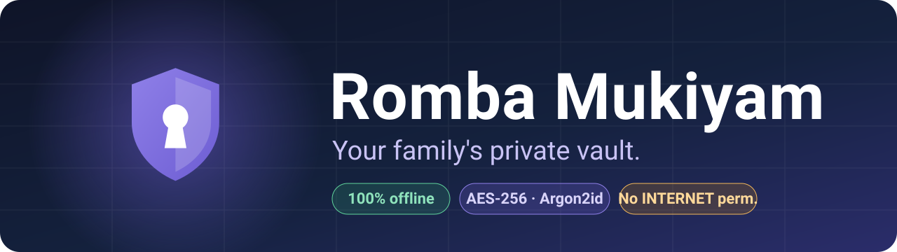

<br/>

[](https://github.com/SRIJAICJ24/romba-mukiyam-/releases/latest)
[](#-install-on-your-phone)


**A free, fully offline alternative to cloud password managers — built for one family.**<br/>
*"Romba Mukiyam" (ரொம்ப முக்கியம்) means **"very important"** — the place where a family keeps what matters most.*

</div>

---

## ✨ What is it?

Romba Mukiyam is not just *username + password* storage. It is a **Family Credential Lifecycle Manager** that
answers the questions a family actually has:

> *What accounts do we have? Who owns each one? What's the customer ID? When was the password last changed?
> When should it be reviewed? How do we recover it? Which passwords are weak or reused? Which cards and documents
> expire soon? When did we last back up?*

Everything lives **on your phone**. There is no server, no account, no cloud, no analytics, no ads — the app
doesn't even request the Android `INTERNET` permission, so it *cannot* phone home.

## 📱 Screenshots

<div align="center">
<table>
  <tr>
    <td align="center">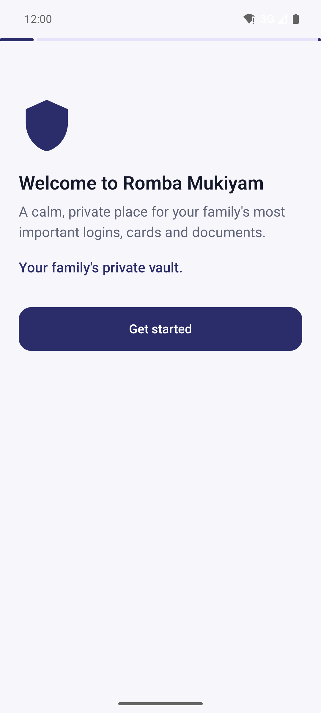<br/><sub><b>Welcome</b></sub></td>
    <td align="center">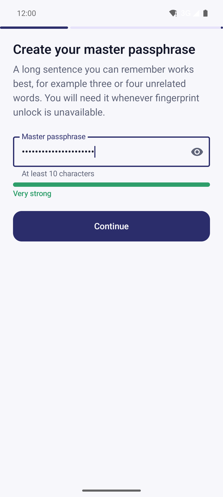<br/><sub><b>Passphrase strength</b></sub></td>
    <td align="center">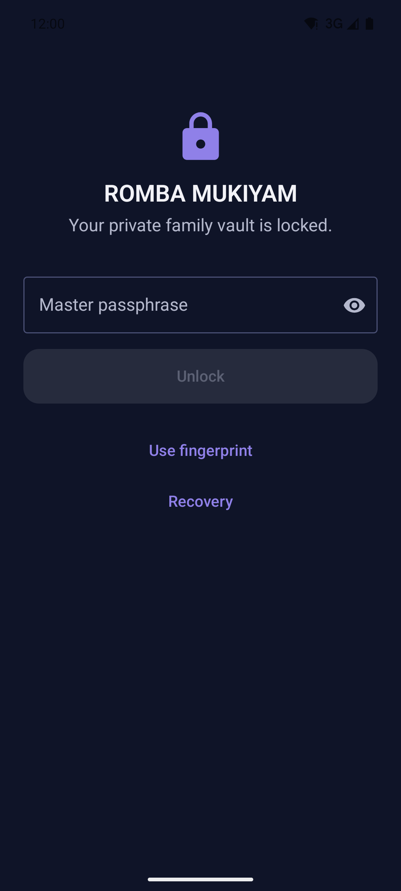<br/><sub><b>Locked vault</b></sub></td>
    <td align="center">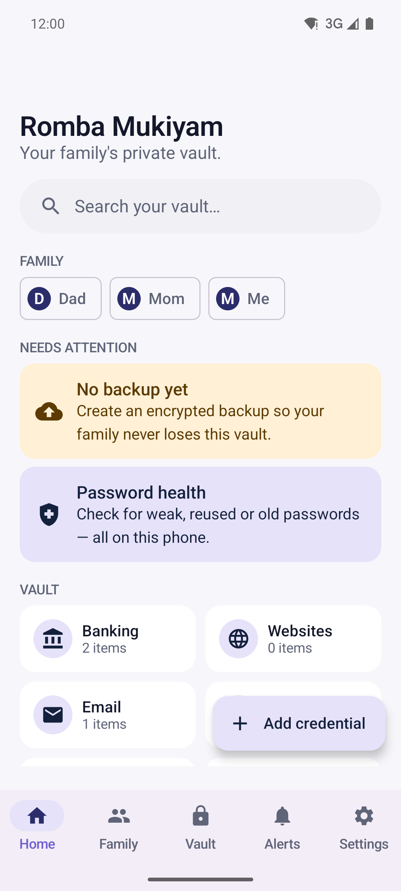<br/><sub><b>Home</b></sub></td>
  </tr>
  <tr>
    <td align="center">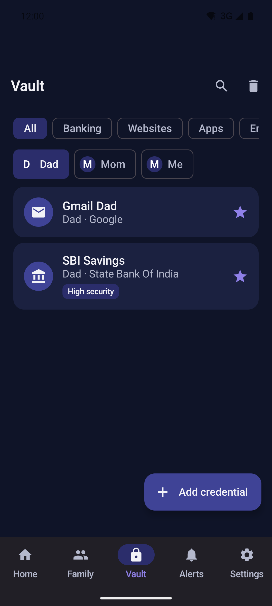<br/><sub><b>Vault</b></sub></td>
    <td align="center">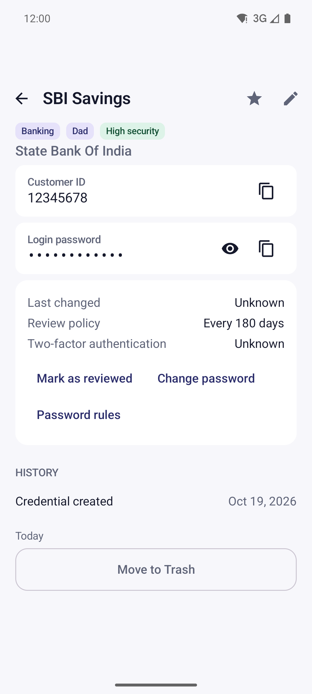<br/><sub><b>Masked secrets</b></sub></td>
    <td align="center">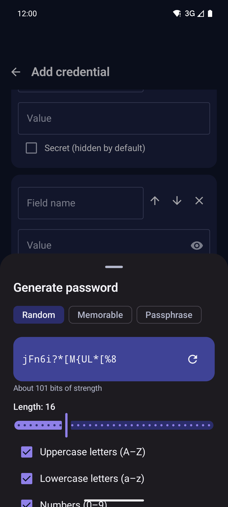<br/><sub><b>Password generator</b></sub></td>
    <td align="center">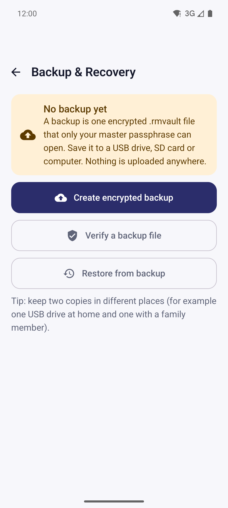<br/><sub><b>Encrypted backups</b></sub></td>
  </tr>
  <tr>
    <td align="center">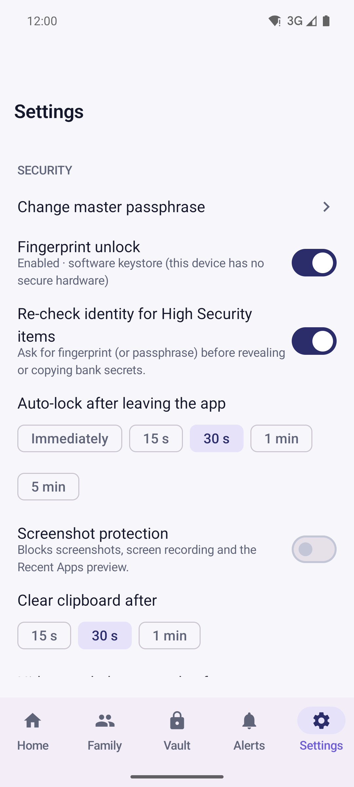<br/><sub><b>Settings</b></sub></td>
    <td align="center">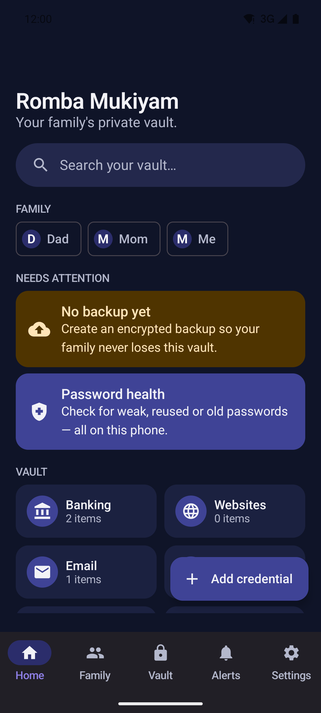<br/><sub><b>Dark theme</b></sub></td>
    <td align="center" colspan="2"><sub>Large type, big touch targets and plain wording — designed for a parent aged 50+.</sub></td>
  </tr>
</table>
</div>

## 🔐 Highlights

| | |
|---|---|
| 🏦 **Flexible credentials** | Bank, Website, App, Email, Card, Identity, Document, Insurance, Investment, Utility, Secure Note, Wi‑Fi — each with a template **and unlimited custom fields** (Customer ID, CIF/CRN, profile & transaction passwords, recovery codes…). Every field is optional because no two banks work the same way. |
| 👨‍👩‍👧 **Family profiles** | Dad / Mom / Me / Sibling / Joint. Profiles are *archived*, never deleted, so a credential can't vanish by accident. |
| 🙈 **Secrets stay hidden** | Masked by default, auto-hide after 15 s, fingerprint re-check for **High Security** items, sensitive-flagged clipboard that clears itself, screenshots & Recent-Apps previews blocked. |
| 🛠 **Password tools** | Random / memorable / passphrase generator, per-account **password rules**, reuse detection (keyed digests — never plain hashes), a guided *manual* change workflow, and a local **health report**. |
| ⏰ **Alerts that respect privacy** | Review reminders (30–365 days), card & document expiry, backup reminders. Notifications say *"1 item needs attention"* — never names, IDs or passwords. |
| 💾 **Verified backups** | Encrypted `.rmvault` files saved to USB / SD / computer. After writing, the app reads the file back and verifies it **before** saying "Backup verified". |
| 🛟 **Safe recovery** | Restore keeps an automatic safety snapshot and runs in one transaction — a failed or corrupt restore leaves your vault byte-for-byte untouched. Safe Mode opens a damaged vault read-only. |
| 🗑 **Trash & history** | 30-day Trash, permanent deletion needs re-authentication, history records *events only* — never old or new passwords. |

**Deliberately not stored:** OTPs, UPI/ATM PINs, CVVs (the form refuses those labels).
**Deliberately not in V1:** cloud sync, autofill, browser extension, AI, TOTP, bank integrations.

## 🛡 Security at a glance

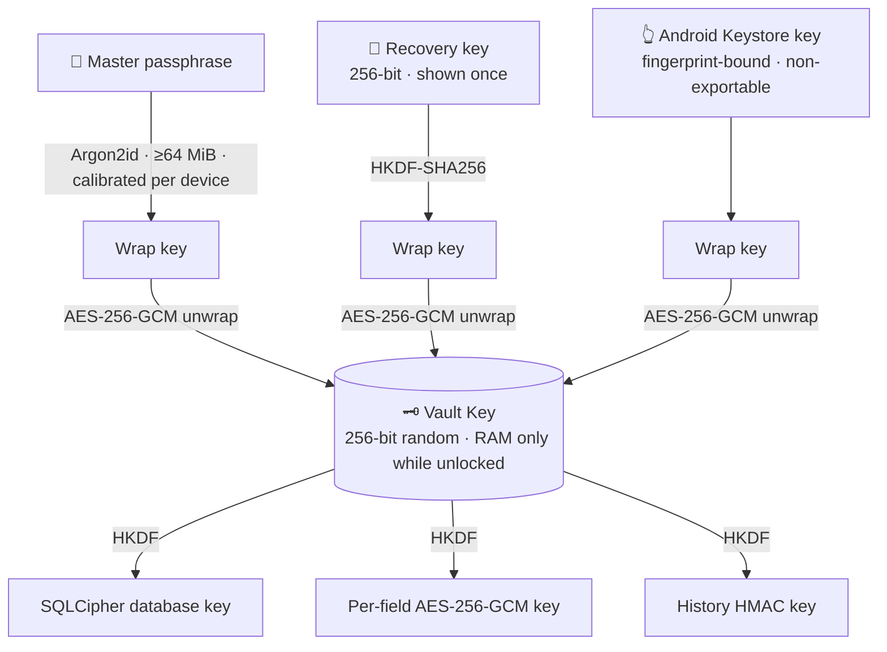

* **No `INTERNET` permission** — verified on the release APK with `aapt2`. `allowBackup=false`, no content providers, no deep links, only the launcher activity is exported.
* **Two layers of encryption:** SQLCipher (AES‑256) database + AES‑256‑GCM on every field value inside it.
* **Fail closed:** if the lock state can't be confirmed, the vault stays locked. After process death the app always reopens locked.
* **No back door:** no developer password, no hidden key, no remote unlock. Lose the passphrase *and* the recovery key and the vault is unrecoverable — by design.
* **Static guard tests** fail the build if destructive migrations, `rememberSaveable`, raw `Log` calls, or the `INTERNET` permission ever appear.

> ⚠️ **Honest note:** this is a personal project reviewed by its author and an automated test suite — **not** an independent security audit. Read [SECURITY.md](SECURITY.md) (threat model + remaining limitations) before storing real credentials.

## 📲 Install on your phone

1. **Download** [`RombaMukiyam-v1.0.0.apk`](https://github.com/SRIJAICJ24/romba-mukiyam-/releases/latest) (11.8 MB) — also kept in this repo under [`release/`](release/).
2. Copy it to the phone and open it. Android will ask you to allow installing from that source *once* — that's the normal sideload prompt.
3. Open **Romba Mukiyam** and follow the onboarding:
   1. Read the offline promise.
   2. Create a **long master passphrase** (a sentence of 4+ unrelated words).
   3. **Write the recovery key on paper** and keep it somewhere safe and separate from the phone.
   4. Enable fingerprint unlock (optional — the passphrase always works).
   5. Create the first family profile and pick a backup reminder.
4. Before trusting it with real data: add a test entry → **Create backup → Verify → Restore** once as a rehearsal.

**Verify your download** (optional but recommended):

```text
SHA-256 (APK)         89e22ca478617371e54c30053c2057e0c90a51bc2246873a92a00c252fb7c9e7
Signing cert SHA-256  bc0093eed202091c08b560fead0d60fcce37fec55d7657366fd6f54da0ece3a9
```

```powershell
Get-FileHash .\RombaMukiyam-v1.0.0.apk -Algorithm SHA256
apksigner verify --print-certs RombaMukiyam-v1.0.0.apk
```

## 🛟 Backup & recovery cheat-sheet

| Situation | What to do |
|---|---|
| Fingerprint stopped working (new fingerprints added) | Unlock with the master passphrase, re-enable fingerprint in **Settings → Security** |
| Forgot the master passphrase | Lock screen → **Recovery** → enter the recovery key → choose a new passphrase |
| Lost / broken / new phone | Install the app → onboarding → **Settings → Backup & Recovery → Restore** → pick the `.rmvault` → enter the passphrase that was current *when that backup was made* |
| "Database reported a problem" at unlock | Choose **Open in Safe Mode (read-only)**, create a backup, then restore a verified backup |
| Lost passphrase **and** recovery key | The vault cannot be opened by anyone. Keep both safe. |

Create backups regularly (the app reminds you) and keep **two copies in two places**. Format details: [BACKUP_FORMAT.md](BACKUP_FORMAT.md).

## 🧱 Tech stack

| Layer | Choice |
|---|---|
| UI | Kotlin · Jetpack Compose · Material 3 · Navigation Compose |
| Architecture | Clean Architecture + MVVM · Hilt · Coroutines/Flow · immutable `UiState` + effects |
| Storage | Room 2.8 over **SQLCipher 4.19** (maintained `sqlcipher-android`) · DataStore for non-secret prefs |
| Crypto | AES‑256‑GCM · HKDF‑SHA256 · **Argon2id** (argon2kt) · HMAC‑SHA256 · `SecureRandom` — *no custom crypto* |
| Device security | Android Keystore (StrongBox when available) · AndroidX BiometricPrompt |
| Background | WorkManager (12 h reminder check, clipboard-clear fallback) |
| Build | AGP 9.4 · Gradle 9.6 · minSdk 26 · targetSdk 36 · compileSdk 37 · R8 |

## 🏗 Build from source

Requires **JDK 17**, Android SDK platform 37 + build-tools 36.

```powershell
$env:JAVA_HOME = "<path-to-jdk-17>"
.\gradlew.bat clean
.\gradlew.bat testDebugUnitTest            # 56 JVM tests
.\gradlew.bat lintDebug                    # lint errors fail the build
.\gradlew.bat connectedDebugAndroidTest    # 38 instrumentation tests (device/emulator with an enrolled fingerprint)
.\gradlew.bat assembleDebug assembleRelease
```

Outputs land in `app/build/outputs/apk/{debug,release}/`.

**Release signing:** `app/build.gradle.kts` reads `%USERPROFILE%\.rombamukiyam\keystore.properties`
(`storeFile`, `storePassword`, `keyAlias`, `keyPassword`) — kept **outside** the repo. Without it the release build is **unsigned**.
Use your own keystore if you build it yourself; updates only install over an app signed with the same key.

## 🧪 What's tested

* **JVM (56):** AES‑GCM tamper / nonce uniqueness / wrong key · HKDF RFC 5869 vectors · recovery-key codec · key hierarchy (create, unlock, change passphrase, recovery, AAD binding, atomic keyring) · generator & policy rules · expiry parsing · error mapping · static security regressions.
* **Instrumented (38), on a real Android runtime:** Argon2id · encrypted DB (wrong key, no plaintext on disk, multi-connection, FK `RESTRICT`) · Keystore key refuses use without biometric · migrations **1→2, 2→3, 1→3** with seeded data · atomic rollback · trash · search (500 items) · backup round-trip · tamper / truncation / wrong-passphrase / newer-schema / weakened-KDF rejection with the live vault byte-identical · reminder-worker notification privacy · Compose onboarding flow.
* **Manually, on the emulator:** SAF backup → verify → restore, recovery-key flow, force-stop → locked, real **APK upgrade from schema v1 → v3** with data intact, and the R8 release build end-to-end.

> Not yet exercised: real fingerprint hardware / StrongBox, reboot survival of the reminder job, a genuinely low-storage device, and a TalkBack audit.

## 📚 Documentation

| Doc | What's inside |
|---|---|
| [SECURITY.md](SECURITY.md) | Key hierarchy, data at rest/in use, threat table, **remaining limitations** |
| [ARCHITECTURE.md](ARCHITECTURE.md) | Layers, session & lock lifecycle, reminders, how to add a feature safely |
| [DATABASE.md](DATABASE.md) | Entities, FKs, indexes, transactions, schema history & migration rules |
| [BACKUP_FORMAT.md](BACKUP_FORMAT.md) | The `.rmvault` byte layout, verification and restore algorithm |

## 🗺 Roadmap (ideas — not in V1)

Android Autofill · Passkeys · TOTP · device-to-device encrypted sync · Tamil UI · desktop companion · emergency family access.

## 📄 License & credits

No `LICENSE` file has been added yet, so by default **all rights are reserved** by the author. Add one (MIT / Apache‑2.0 / GPL‑3.0 …) if you want others to reuse the code.

Built with: AndroidX / Kotlin / Hilt (Apache 2.0) · [SQLCipher for Android](https://github.com/sqlcipher/sqlcipher-android) (BSD‑style) ·
[Argon2Kt](https://github.com/lambdapioneer/argon2kt) (MIT) over the Argon2 reference implementation (CC0 / Apache 2.0) ·
[EFF short wordlist](https://www.eff.org/dice) (CC BY 3.0).

<div align="center"><sub>Made for a family, with care. 🛡 <i>Your family's private vault.</i></sub></div>
